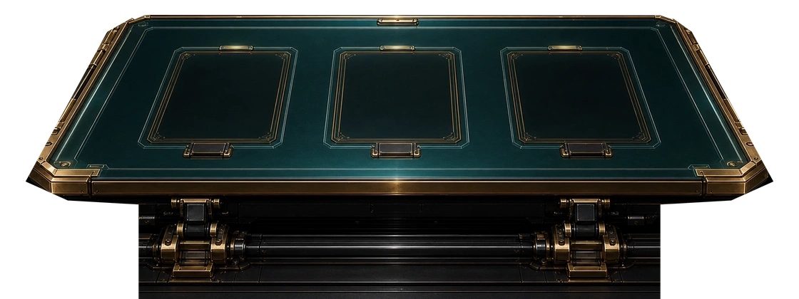

# カードテーブル全体3D化 実装仕様書

2026-11-13。実装担当 Claude。完成時の静止画は現行の `card-table-premium-three-bay-center-only-1120x420.webp` と同じ構成、輪郭、材質、色、スロット位置を再現する。以下の寸法はCGワールド単位。カメラ・スロットは確定値。外装・装飾は原画の輪郭から採った初稿値で、原画重ね合わせで固定部のみ詰める。

## 差分の起点と座標

1. `git show 6daa860:lib/table-3d/cabinetTable3D.ts` から固定フェルト、開口、枠、ウェルの構成を取り出し、現行ファイルに移植する。旧版の大きな矩形フェルトと、枠を一緒に回す大判プレートは採用しない。
2. 現行の回転プレート、遮蔽、`tableBridge.ts`、`rideSlotFlip`、マウントと破棄処理を起点にする。固定部と可動部は別グループ。
3. ワールドは X が画面右、Y が上、Z が手前。論理面 Y=0。カメラ (0, 1.8549, 2.3988)、X回転 −48.849°、垂直FOV 22.3608°、yaw/roll 0、near 0.1、far 40。原画1120×420、基準アスペクト8:3。再フィット禁止。異なるCSS寸法では同じアート矩形に投影を合わせ、DPRは解像度だけに使う。
4. スロット中心 X=−0.7215 / 0 / ＋0.7215、halfW=0.2256、zFar=0.3818、zNear=0.8298。開口 0.4512×0.4480、中心Z=0.6058。静止投影の基準は既知のRMS 2.65px。これは原画と物理投影の差であり、Pixi座標を変更する根拠にしない。

## 固定部寸法

| 部位 | 形状・寸法 |
|---|---|
| 天板外形 | Y=0で、XZ頂点を奥左から順に (−0.9755,0.0844)、(0.9755,0.0844)、(1.0573,0.1441)、(1.1646,0.8912)、(1.1041,0.9199)、(−1.1041,0.9199)、(−1.1646,0.8912)、(−1.0573,0.1441)。原画上の目印は順に (205,20)、(915,20)、(950,34)、(1078,248)、(1055,258)、(65,258)、(42,248)、(170,34)。 |
| 外周真鍮・前面 | 外周から内側へ幅0.024。外側ベベル幅0.010、落差0.012、3分割。前面の厚み0.075、Y=0〜−0.075。前角は外形の面取りをそのまま押し出し。内側の二重線は幅0.0018、間隔0.004、縁内端から0.009。奥中央に幅0.155×奥行0.021、厚み0.006の真鍮留め具。 |
| フェルト | 真鍮内端からさらに0.004内側。Y=0の面、厚み0.008。開口位置は固定。枠下に0.003重ねて継ぎ目を隠す。 |
| 各ベイの固定枠 | X/Z各辺にRIM 0.034を足した外形0.5192×0.5160。Z=0.3478〜0.8638。角落とし0.018。外周→内側の断面は、幅0.009でY=0→＋0.009、幅0.011の頂面、幅0.014で開口縁へ落とす。内側斜面の終点Y=−0.006。ベベル3分割、面の境界に法線の差を残す。開口側に面を張り出させない。 |
| ベイ二重線・金具 | 開口縁から外側へ0.006と0.011の位置に幅0.0016の金線。角に長さ0.022、幅0.003の真鍮アクセント。奥留め具は各ベイ中央X、Z=0.350、幅0.096×奥行0.018×厚0.008。手前留め具はZ=0.854、幅0.155×奥行0.038×厚0.012。黒い中央キャップ0.107×0.025と左右の真鍮金具を分離。開口と交差する部分は切り欠く。 |
| ウェル | 開口に沿った四壁、厚み0.009。Y=−0.012から−0.260、底Y=−0.260。可動プレートの最大掃引半径0.2258＋余裕0.010を確保。現行Y=−0.012の浅い裏当ては必要な場合のみ残し、回転中の遮蔽を実機比較して決める。 |
| 下部機構 | 台座X=±0.8295、Y=−0.260〜−0.234、Z=0.915〜1.1792。黒い横軸はX=±0.821、中心(Y,Z)=(−0.160,1.039)、半径0.043、16面。左右支持具はX=±0.625、幅0.156、奥行0.182、Y=−0.234〜−0.075。各支持具の軸カラー幅0.023、半径0.053。中央奥の内部は暗く落とす。台座は下端で原画同様に画面外へ続いてよい。 |

外形は元画像の切り欠きに沿う。旧版の広い四角形や左右を切る不透明な背景面は置かない。固定外装の左右端・機構端に、投影画像換算で外縁から内側へ0〜10pxのアルファフェードを適用する。中心側は不透明。金具輪郭の明瞭さを残し、下部の左右端は影で溶かす。回転の深度遮蔽はアルファ処理とは独立させる。

## 材質と照明

| 部位 | 初期設定 |
|---|---|
| フェルト | sRGB生成マップ1024×512。奥#102a2e、中間#17383c、手前#153338。中心(X,Z)=(0,0.62)に半径(0.82,0.31)の柔らかな青緑ハイライト、左右端は中心よりRGB各8〜12階調暗くする。固定seed 260113の微細織りをRGB±3階調、0.004周期で入れる。roughness 0.92、metalness 0。薄い生成バンプ強度0.0012。座標はワールド基準で開口前後の模様を連続させる。 |
| 枠の青緑金属 | 色#335a5d、metalness 0.52、roughness 0.36。面取りは別法線で反射を拾わせる。エッジの色目安#83a0a0。 |
| 真鍮 | 色#b88948、metalness 0.72、roughness 0.33。金線は#c79a4e、roughness 0.42。留め具の黒部#15191c、roughness 0.55。外周前面は#73502cを基準に上縁だけ光を拾わせる。 |
| ウェル・下部 | ウェル#03070a、roughness 1。下部軸#15181b、metalness 0.55、roughness 0.43。 |
| 可動面 | 現行生成マップ原画色#0e1a1b、ACES exposure 0.98、現行emissiveIntensity 1.9を保持。静止画面の中央サンプル目標#0c1a1a、RGB各±3。黒や拡散材質だけで近似しない。 |

初期照明は現行値を使用。半球 #9fd8ff/#08161a・0.35、暖色キー #fff2dc・2.4・位置(−1.6,3.0,2.6)、青色フィル #6fb8d8・0.8・位置(2.4,1.4,1.2)。ACES/sRGB設定を現行と揃える。静止原画との色合わせはマテリアルと生成マップで行う。金属が沈む場合は白い反射帯を持つ小さな生成環境マップを一度だけ生成し、背景には表示しない。

固定枠に独立した発光材質を持たせ、`setSlotHighlight(index, color, intensity)` を追加。既定0、強度0〜1。枠に沿う細い帯だけを発光させ、PixiのReplyフレームスパークを代替しない。照明連動用に `setCabinetReaction(color, intensity)` を追加。既定0、強度0〜1。既存 `bcab-react-*` を持つ側から状態変更時に渡し、補助フィルを最大＋0.35だけ変える。可動面のベース発光は維持。初回は両APIを接続可能な状態までとし、通常プレイで新演出を有効化する必要はない。

## 回転・受け渡し

- プレート厚0.014。各軸は(X中心, Y=0, Z=0.6058)、ローカルZ回りに独立してπ回転。既定420ms、現行の加減速、`flipSlot(index, durationMs?)` の時間指定を維持。両面同じ空の挿入部。完了時はπの整数倍で静止。カードは既存の `rideSlotFlip` に従い、消えたカードが裏面から再出現しない。
- 上側は現行のローカルクリップ（Y≤0.009、静止プレート天面Y=0.007を含む）を維持し、固定枠頂面Y=0.009を越える可動部は描かない。下側は3穴を切った現行depth-only面を保持し、固定メッシュにも深度を書かせる。表面の着色ジオメトリが穴を塞がないこと。Pixiは別キャンバスなので、現行の静止開口マスクも保持する。
- `slotQuads()` は静止時の四隅を順序含め現行どおり返す。`livePlateQuad(index)` は同じ局所四隅を当該フレームのpivot世界行列で変換して投影する。辺の入れ替えやAABB化をしない。どちらもcanvasローカルのCSS px。 `tablePointToPixi` は現行どおりtable client box→viewport→Pixi論理座標。物理ピクセルとCSSピクセルを混ぜない。

## マウント・性能

`.bcab-card-table` 内の既存 `CabinetTable3D` を拡張し、透過canvasをPixiより下に置く。 `pointer-events:none`。開発時の `CARD_TABLE_3D` で切り替える。最初の描画成功後に限り当該要素の焼き込み背景を隠す。初期化失敗、コンテキスト喪失、無効時は元の画像を表示し、既存フォールバック動作へ戻す。本番の既定は焼き込み画像。不要な別canvasを追加しない。

固定材質ごとに結合し、3ベイでジオメトリを共有。目標は静止24 draw calls以下、3枚同時回転32以下、15,000 triangles以下。DPR上限1.5、iPhoneは1を初期値。生成テクスチャ計8 MiB以下（ミップ込みのGPU見積り）。シャドウマップ、ポスト処理、動画テクスチャなし。静止時は変更時だけ描き、回転中のみ既存Pixi連携を保って更新。ResizeObserverと既存disposeを維持。Safari/iPhoneのWebGL2実機で試し、使えない端末では画像へ戻す。追加画像は予定しない。例外が必要なら理由を記録し、新規ファイル名を `.v2.webp` 等で版管理して参照を切り替える。

## 受け入れ条件

1. 1120×420の同一CSS矩形で原画と3Dを重ね、天板シルエット・固定枠・留め具の主要目印は原画から4px以内を目標。左右端に矩形の線がなく、暗部、布のグラデーション、青緑の挿入部、下部の軸と真鍮支持具が再現されている。3D静止四隅は現行3Dから各点0.25 CSS px以内。原画とのRMS 2.65pxは丸めを含め2.7px以内。
2. `CABINET_TABLE_SLOT_QUADS`、`CABINET_TABLE_SECTIONS`、`TABLE_PLANE_*`、`projectPixiPointToCabinet`、`projectCabinetQuadToPixi` は差分なし。同じ決定済み結果をON/OFFで比較し、カード着地、ホバー、当たり判定、ターゲットマーカー、リールトレース、面のforeshorten、射出の受け渡し、ReplyフレームスパークのPixi論理座標が変わらない。
3. 各スロット単独と3枚同時について、0/25/50/75/100%を撮影。カードはプレートに追従し、天板や固定枠の上を横切らず、開口の外へは見えない。終了後の空きスロットを次の手に使用できる。420msおよび変更値600msで確認。
4. キャビネット表示倍率0.5/0.75/1、デスクトップと390×844、DPR1/2で比較。canvas→Pixiの往復誤差0.5 CSS px以下。リサイズ中・退場・再入場で古いcanvasやbridgeが残らない。無効時・初期化失敗時・本番ビルドで焼き込み画像に戻る。
5. 同じ手・同じ機種・同じ設定で60秒ずつ画像版と比較。平均FPSの悪化3%以内、フレーム時間p95の増分2ms以内を初稿の合格線とする。Pixiのエフェクトと3枚同時回転を含め、PC ChromeとiPhone Safariで測る。未計測機種と未検証のフォールバック条件は引き継ぎに記録する。

実装順は、固定部の差分移植と静止比較 → 現行回転の遮蔽確認 → Pixiの回帰確認 → 発光・照明の接続口 → 実機計測。座標がずれた場合は先にcanvasの基準矩形と投影を調べ、Pixi定数を補正して合わせない。
